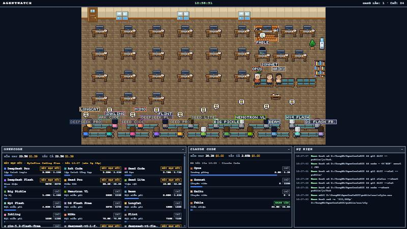

# AgentwatchUI

Văn phòng pixel art cho biết model AI nào đang làm việc trên máy này.

- Model chạy qua **opencode** đang làm việc thì ngồi vào bàn máy tính; model rảnh ngồi
  ở hàng ghế chờ phía dưới.
- Model của **Claude Code** ở góc trưởng phòng (bên phải). Khi trưởng phòng soát bài
  của một worker, nó đi tới bàn worker đó và cầm bảng ghi.
- Model của nhà cung cấp đang hết hạn mức có bong bóng đồng hồ cát; dải dưới ghi giờ
  hồi lại (ví dụ `HẾT HẠN MỨC · BytePlus Coding Plan · hồi 13:37`).
- Dải dưới màn hình: số token hôm nay và tổng cộng của từng model, cho cả opencode
  và Claude Code, kèm nhật ký các lệnh gần nhất.



## Chạy

Bấm đúp `start.bat`. Cần Node.js 22.5 trở lên (dùng `node:sqlite` có sẵn, không cài
gói nào). Trình duyệt mở `http://127.0.0.1:4780`. Đổi cổng: đặt biến `PORT`.

Xem thử không cần dữ liệu thật: `http://127.0.0.1:4780/?demo=1`.

## Dữ liệu lấy từ đâu

| Nguồn | File | Ghi chú |
|---|---|---|
| opencode | `~/.local/share/opencode/opencode.db` | Mở chỉ đọc. Đang làm = có hoạt động trong 25 giây gần nhất. |
| Claude Code | `~/.claude/projects/**/*.jsonl` | 30 ngày gần nhất. Đang làm = file phiên vừa đổi trong 90 giây. |
| Cờ review | `~/.agentwatch/review.json` | Do `node bin/aw.js review <id model> [ghi chú]` ghi; `--done` để tắt. |

Giới hạn: chỉ đếm **token**. Phần trăm hạn mức đã dùng không có trong các file này.
Giờ hồi hạn mức chỉ biết được sau khi một model đã bị chặn, lấy từ chính thông báo lỗi. Cột tiền của opencode là số
opencode tự ước tính theo bảng giá công khai, không phải hóa đơn.

Danh sách model, chức vụ và màu áo: `config/roster.json`. Model lạ có hoạt động trong
24 giờ gần nhất tự hiện với chức vụ "Khách".

## Dự án này được làm thế nào

Claude Code điều hành, các model opencode viết phần lớn mã theo brief trong `briefs/`
và hợp đồng `docs/SPEC.md`. Cách điều hành, bảng model theo chức vụ và các lệnh chạy:
[`orchestra/RUNBOOK.md`](orchestra/RUNBOOK.md).

| Phần | Người làm |
|---|---|
| Backend (`server.js`, `lib/`, `bin/`, test) | DeepSeek V4 Pro |
| HUD (`index.html`, `style.css`, `hud.js`) | DeepSeek V4.1 Flash |
| Cảnh three.js (`office.js`, `layout.js`, `main.js`) | Ark Code, rồi Big Pickle sửa chỗ ngồi |
| Đồ đạc, bong bóng, bảng tên (`sprites.js`) | Seed 2.0 Code, rồi Hy4 Flash vẽ lại toàn bộ |
| Giờ hồi hạn mức (backend và HUD) | Beam |
| Bàn máy tính riêng cho model Claude, đồ trang trí | Hy4 Flash |
| Nhân vật (`drawCharacter`), bố cục dải dưới, vá backend | Claude Fable 5.2 |

## Kiểm tra

```bash
npm test
```

24 test: gộp usage, giờ hồi hạn mức, khử trùng `message.id`, ngưỡng đang làm/rảnh, cờ review, bố cục bàn ghế.
